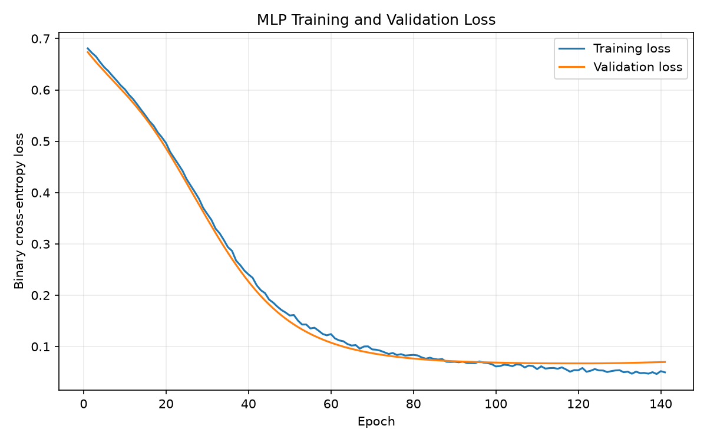
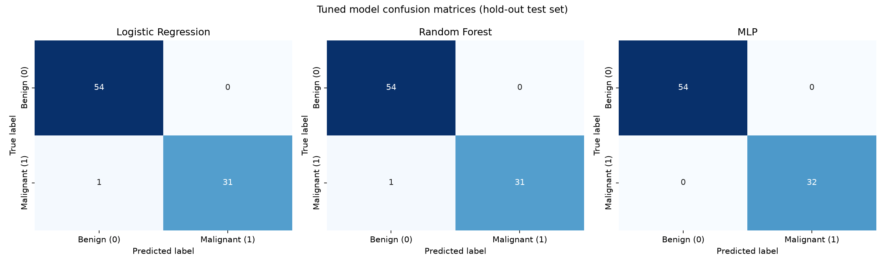

<div align="center">

# 🎗️ Breast Cancer Classification

### Machine Learning & Deep Learning on the Wisconsin Diagnostic Breast Cancer (WDBC) Dataset

**DS471 · Course Project**


</div>

---

## 📌 Overview

This project builds and compares machine learning and deep learning models to classify breast tumors as **malignant (M)** or **benign (B)** using the 30 numeric features of the WDBC dataset, computed from digitized images of fine needle aspirates (FNA) of breast masses.

**Goals**

- Perform exploratory data analysis (EDA) to understand feature distributions and class balance.
- Build a leakage-free preprocessing pipeline.
- Train and compare classical ML and deep learning models.
- Evaluate with metrics that matter in a medical setting (recall, precision, F1, ROC-AUC).

---

## 📊 Dataset

| Property | Value |
|---|---|
| Source | Wisconsin Diagnostic Breast Cancer (WDBC) |
| Samples | 569 |
| Features | 30 numeric features |
| Target | `diagnosis` → `M` (malignant) = 1, `B` (benign) = 0 |
| Excluded | Identifier column (`id`) |

> The raw file is stored locally at `data/raw/breast_cancer.csv` and is **not tracked by Git**.

---

## 🗂️ Project Structure

```text
DS471Project/
├── data/
│   ├── raw/            # Raw data (local only, ignored by Git)
│   └── processed/      # train / val / test splits (local only, ignored by Git)
├── notebooks/          # Jupyter notebooks for experiments
├── reports/
│   └── figures/        # Visualizations and performance plots
├── src/
│   ├── initial_eda.py  # Exploratory data analysis
│   ├── preprocess.py   # Preprocessing pipeline
│   ├── train_traditional.py # Traditional ML baselines
│   ├── train_neural_net.py # MLP training pipeline
│   └── evaluate_tune.py # Cross-validated tuning and test evaluation
├── requirements.txt
└── README.md
```

---

## ⚙️ Setup & Installation

**1. Clone the repository**

```bash
git clone https://github.com/turki013/DS471Project.git
cd DS471Project
```

**2. Install dependencies**

```bash
pip install -r requirements.txt
```

**3. Add the dataset**

Place the WDBC file at:

```text
data/raw/breast_cancer.csv
```

---

## 🚀 How to Run

### Quick Start

```bash
# Optional initial inspection:
python src/initial_eda.py
# Required end-to-end pipeline:
python src/preprocess.py
python src/train_traditional.py
python src/train_neural_net.py
python src/evaluate_tune.py
```

The preprocessing step validates the raw file, encodes the target, creates
stratified train/validation/test splits, and fits scaling on training data
only. The next two commands train the classical and neural-network
baselines. The final command runs five-fold tuning on train plus validation
and evaluates the selected models on the untouched test partition.

The end-to-end demonstration is available in
`notebooks/breast_cancer_pipeline_demo.ipynb`.

**Outputs** (local data and generated figures):

```text
data/processed/train.csv
data/processed/val.csv
data/processed/test.csv
reports/figures/mlp_learning_curves.png
reports/figures/confusion_matrices.png
```

---

## 🛡️ Data Leakage Prevention

- The identifier column is **excluded** from the model features.
- The scaler is **fitted on the training set only**, then applied to validation and test sets.
- Splits are **stratified** to preserve the class ratio across partitions.
- Hyperparameter tuning uses train plus validation folds; the test set remains untouched.

---

## 🤖 Models

| Type | Model | Status |
|---|---|---|
| Machine Learning | Logistic Regression | ✅ Baseline and tuned |
| Machine Learning | Random Forest | ✅ Baseline and tuned |
| Deep Learning | Multi-Layer Perceptron (Neural Network) | ✅ Baseline and tuned |

---

### Traditional ML Baselines

```bash
python src/train_traditional.py
```

The baseline models report Accuracy, Precision, Recall, F1-Score, and ROC-AUC
on validation and test partitions. Model weights and metrics are not persisted
by the baseline script.

### Neural Network (MLP)

```bash
python src/train_neural_net.py
```

Architecture:

```text
30 inputs → 64 (ReLU) → Dropout(0.2) → 32 (ReLU) → 1 output
```

Training uses Adam with a learning rate of `0.001` and
`BCEWithLogitsLoss`. Validation loss is tracked every epoch, with early
stopping and restoration of the best validation checkpoint. The learning
curve is saved to `reports/figures/mlp_learning_curves.png`.

### Hyperparameter Tuning and Evaluation

The tuned test results are:

| Model | Accuracy | Precision | Recall | F1 | ROC-AUC |
|---|---|---|---|---|---|
| Logistic Regression (tuned) | 0.9884 | 1.0000 | 0.9688 | 0.9841 | 1.0000 |
| Random Forest (tuned) | 0.9884 | 1.0000 | 0.9688 | 0.9841 | 1.0000 |
| Multi-Layer Perceptron (MLP) | 1.0000 | 1.0000 | 1.0000 | 1.0000 | 1.0000 |

---

## 📈 Performance Visualizations





The learning curves show training and validation loss across epochs. The
confusion matrices show the error distribution for each tuned model on the
hold-out test set.

---

## 🩺 Medical Context & Takeaways

In breast cancer screening, **recall is critical** because a false negative
can classify a malignant tumor as benign and delay clinical follow-up.
Therefore, model selection should consider sensitivity alongside precision,
F1-score, ROC-AUC, and the cost of false positives. The reported metrics are
experimental results on this dataset and are not a substitute for clinical
validation or medical diagnosis.


## 📚 References

- Wolberg, W. H., Street, W. N., & Mangasarian, O. L. — *Wisconsin Diagnostic Breast Cancer (WDBC)*, UCI Machine Learning Repository.

---

<div align="center">

Made for DS471 

</div>
